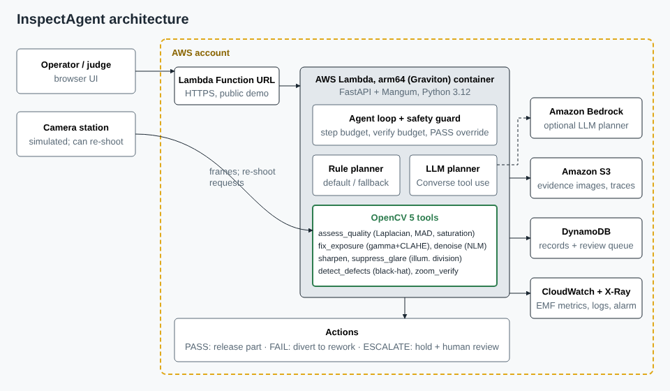
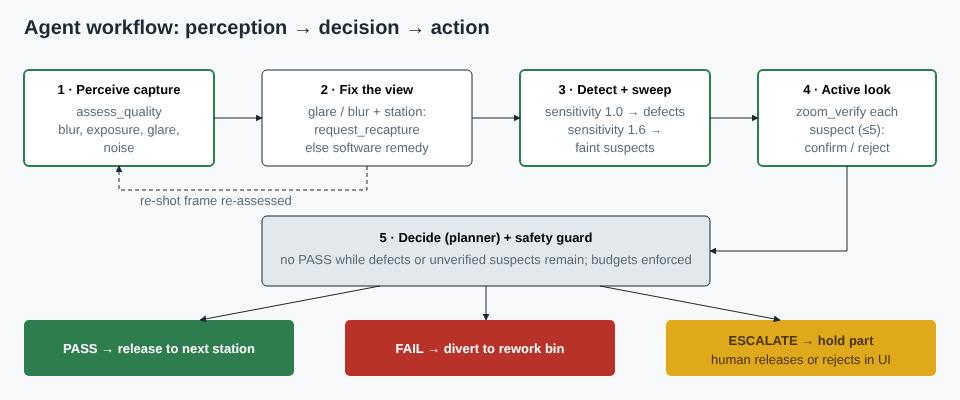

# InspectAgent

**Agentic surface inspection with OpenCV 5 on AWS.** An agent looks at a part, judges whether the photo is good enough to decide on, fixes the view (re-shoots the part, corrects exposure, removes noise, flattens glare), detects defects, zooms in to verify anything uncertain, and then acts: release the part, divert it to rework, or hold it for a human.

Entry for the [OpenCV AI Competition 2026, powered by AWS](https://opencv26.devpost.com/) — targeting the Overall awards and the **Agentic Vision** special award. Competition notes: [docs/COMPETITION.md](docs/COMPETITION.md).



## Why

Automated visual inspection mostly fails on bad captures, not on hard defects: glare from a reflective part, an out-of-focus frame, a dim station. A single-pass detector either misses defects hidden by the bad frame or rejects good parts. InspectAgent treats image quality as something it can act on, and refuses to pass a part it couldn't properly see.

## Results (held-out, 500 parts, seeds 20000–20499)

| | Single-pass OpenCV baseline | InspectAgent (station can re-shoot) | InspectAgent (upload only, no re-shoot) |
|---|---|---|---|
| Defective parts that escaped as PASS | **36 / 290** | **0 / 290** | **0 / 290** |
| Good parts wrongly rejected | 0.0% | 0.0% | 1.9% |
| Sent to human review | 0% | 0.6% | 12.2% |
| Accuracy on parts decided automatically | 92.8% | 100% | 99.1% |
| Defect-level recall / precision | 85.5% / 100% | 99.7% / 99.3% | 99.2% / 97.3% |
| Mean latency (local CPU) | 19 ms | 67 ms | 66 ms |

Data is synthetic (rights-clean, generated with known ground truth); see [Limitations](docs/TECHNICAL_REPORT.md#9-limitations-and-failure-cases). Full metrics: `eval/results/*/metrics.json`, per-part outcomes and failure images in the same folders.



## How the agent works

| Step | OpenCV 5 tool | What its output changes |
|---|---|---|
| Perceive | `assess_quality` — tiled Laplacian energy, robust noise (MAD), saturation fraction, mean exposure | Chooses the next action |
| Fix the view | `request_recapture` (station) or `fix_exposure` (gamma + CLAHE), `denoise` (non-local means), `sharpen` (unsharp mask), `suppress_glare` (illumination division + saturation mask) | The re-shot or corrected frame is re-assessed |
| Detect | `detect_defects` — black-hat morphology, median/MAD threshold, connected components, shape features (elongation, solidity) → scratch / pit / crack | Confirmed defects vs. uncertain suspects |
| Sweep | `detect_defects(sensitivity=1.6)` | Faint regions become suspects |
| Look closer | `zoom_verify` — crop + 2× cubic upsample + local re-detection | Each suspect is confirmed or rejected |
| Act | `finalize` → release / divert to rework / hold for human | Part is routed; held parts appear in the review queue |

Two planners choose the tool sequence: a deterministic **rule policy** (default; used for evaluation) and an **LLM planner on Amazon Bedrock** using Converse tool-use. Both run behind the same guard: tool whitelist, step budget (16), verification budget (5), re-shoot budget (2), and a hard rule that a part cannot be PASSed while defects or unverified suspects remain. If Bedrock fails, the step falls back to the rule policy and the trace records it. Every step is logged with its reason, OpenCV observation and latency — see [docs/traces/](docs/traces).

## Run locally

```bash
python3 -m venv .venv && . .venv/bin/activate
pip install -r requirements-dev.txt
pytest -q                                  # 14 tests
uvicorn inspectagent.app:app --port 8000   # open http://localhost:8000
./eval/run_all.sh                          # reproduce the results table
```

In the UI: pick a capture condition (try **Glare**), press **Shoot and inspect a part**, and read the agent's steps on the right. Expand "OpenCV output" on any step to see the raw observation. Upload a photo to see the no-re-shoot path; held parts can be released or sent to rework by a named reviewer.

## Deploy to AWS

Requires AWS CLI credentials, [SAM CLI](https://docs.aws.amazon.com/serverless-application-model/latest/developerguide/install-sam-cli.html) and Docker.

```bash
./deploy/deploy.sh                                            # rule planner
BEDROCK_MODEL_ID=<model-or-inference-profile-id> PLANNER=bedrock ./deploy/deploy.sh   # with LLM planner
```

Creates: an arm64 (Graviton) Lambda container behind a Function URL, a private encrypted S3 bucket (evidence images, full traces, 90-day expiry), a DynamoDB table (inspection records + review queue), CloudWatch EMF metrics (`InspectAgent` namespace: inspections, latency, agent steps, re-shoots by disposition), X-Ray tracing and an error alarm. Reserved concurrency is capped at 10 to bound cost on the public URL. The script prints the demo URL.

## API

| Method | Path | Purpose |
|---|---|---|
| `POST` | `/api/station/inspect?degradation=&defects=&seed=&planner=` | Simulated station shoots a part; agent may request re-shoots |
| `POST` | `/api/inspect` (multipart `file`) | Inspect an uploaded PNG/JPEG (no re-shoot available) |
| `GET` | `/api/inspections?status=pending` | Recent inspections / review queue |
| `GET` | `/api/inspections/{id}` | Full record with trace |
| `POST` | `/api/inspections/{id}/review` `{decision, reviewer, note}` | Human resolves a held part |
| `GET` | `/api/eval`, `/api/health` | Bundled evaluation metrics; status |

## Repository

```
inspectagent/  vision.py (OpenCV 5 tools) · agent.py (loop, planners, guard) · synth.py (data + station)
               store.py (local / S3 + DynamoDB) · app.py (FastAPI + Lambda) · static/index.html (UI)
eval/          run_eval.py, run_all.sh, results/
deploy/        template.yaml (SAM), deploy.sh       Dockerfile (Lambda arm64)
docs/          TECHNICAL_REPORT.md, VIDEO_SCRIPT.md, diagrams, example traces
tests/         pytest suite
```

Stack: OpenCV 5.0.0 (`opencv-python-headless==5.0.0.93`), Python 3.12, FastAPI, Mangum, boto3. All dependencies pinned in `requirements.txt`.
